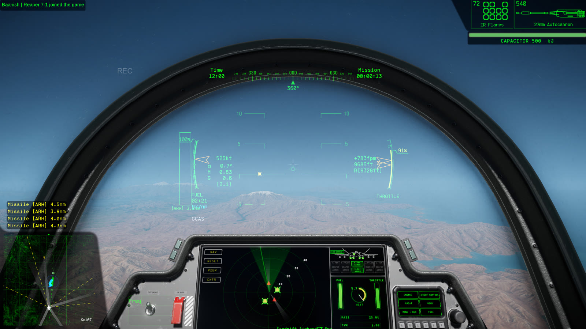
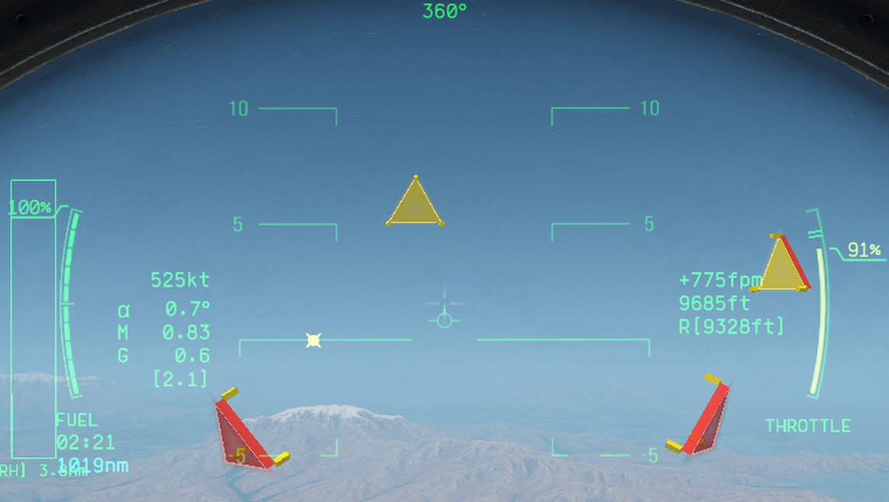

# NO Missile Indicators

My Nuclear Option mod that marks every incoming missile, so you can find it in time to break its lock or shoot it down. **Missile Arrows → Style** picks the look.

**Arrows**, the default. A red arrow on a ring around your HUD points the way to turn toward each missile outside your view, flashing red and yellow like the game's missile warning. A missile behind you gets its arrow on the side it's on, and the arrow goes away once the missile is on screen.

**Project Wingman.** Every warned missile gets a 3D plate on a sphere around you, turned to face it, the way Project Wingman draws its missile indicator. The side facing the missile is red, so a missile behind you shows a red plate and one ahead shows the yellow back.

**To install, follow the [install guide](docs/INSTALL.md).** The mod isn't in the Nuclear Option Mod Manager catalog yet.

## It shows only what the game's warning knows

Only missiles the game's missile warning already knows about get an arrow. Each arrow points where the game's own flashing HUD marker for that missile sits, so it tells you nothing the HUD hasn't. When the game marks a missile's position as outdated, its arrow stays at the last known position and fades to half, as the game's marker does.

The mod only draws on your screen. It doesn't patch the game and sends nothing over the network, so nobody else sees the arrows. To turn them off without uninstalling, switch off **General → Enabled** in the settings.

## Off in PvP unless you turn it on

In a player-versus-player game the arrows are off by default. That's any multiplayer game where another human player isn't on your faction, including one still joining or watching before picking a side, or where the mod can't tell. Against another player, an arrow toward every incoming missile may be a competitive advantage, even though it only shows what the game's warning knows. **Missile Arrows → Allow in PvP** turns them on there. Only do that when the other players know and agree.

Single player, co-op against AI, and multiplayer with other humans only on your side are not PvP, so the arrows show there.

## It used to ship inside Baanish UI Improvements

The arrows shipped inside Baanish UI Improvements up to 0.4.0. That mod is now [NO Map Overhaul](https://github.com/baanish/NO-Map-Overhaul), a map-only mod, and the arrows live here. If you still run Baanish UI Improvements 0.4.0 or earlier, update it to NO Map Overhaul 0.5.0 or later, or you'll see two arrows per missile. The first time this mod loads, it copies your arrow settings from the old mod's settings file.

## Requirements

- Nuclear Option 0.34.2.
- BepInEx 5, tested with 5.4.23.4.
- Optional: [BepInEx Configuration Manager](https://github.com/BepInEx/BepInEx.ConfigurationManager) to change settings in game with F1.

## Documentation

- [Install guide](docs/INSTALL.md): BepInEx, the mod, updating, and uninstalling.
- [User guide](docs/USER_GUIDE.md): what the arrows show, when they're off in PvP, and every setting.
- [How it works](docs/DESIGN.md): how an arrow is placed and what the mod reads from the game.
- [Testing](docs/TESTING.md): the automated tests and what's been checked in game.

## Contributing

Bug reports and ideas are welcome. Include your game and mod versions, a screenshot, and what you expected to see. See [contributing](CONTRIBUTING.md) to build it yourself.

## License

[MIT](LICENSE). Nuclear Option and its assets belong to their respective owners.
